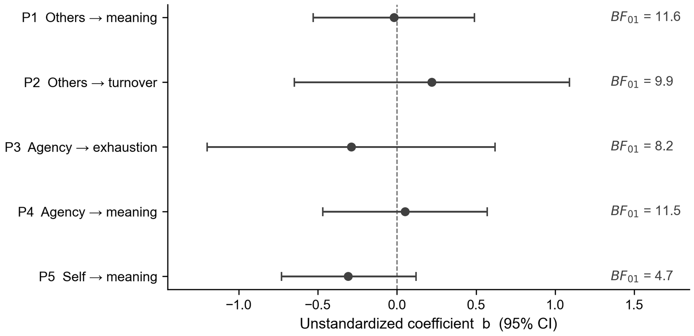

# The AI Paradox: How Optimization May Undermine Meaningful Work in Helping Professions (2026)

Key findings

<ol>
<li>The study&rsquo;s six planned predictions did not hold. The prespecified dimensions of meaning that helping-profession workers described in their work did not clearly forecast their outcomes a year later. All six planned estimates were near zero.</li>
<li>One of four unplanned results that survived screening was that stories that grounded meaning in competence or mastery were associated with higher turnover intentions and emotional exhaustion a year later, compared with stories without that code. It rests on 17 coded stories and needs a designed test.</li>
<li>In a decade of nursing-forum posts (7,695 posts, 5,429 coded meaning events), about one post in twenty named an optimization practice, such as staffing ratios or documentation load, or a system rollout, in every capture period; 49% of the 629 events that named any object concerned control and autonomy over the work. The study did not measure any worker&rsquo;s own exposure to AI.</li>
</ol>

<a class="companion-btn" href="https://mjmonnot.github.io/lec-2026/">Companion site for this paper &rarr;</a>

**Authors:** Matthew J. Monnot & Isaac Thompson  
**Outlet:** *PsyArXiv preprint*  
**PDF:** [Download preprint PDF →](/assets/pdfs/Monnot_Thompson_2026_AI_Paradox_PsyArXiv_jzngq.pdf)  
**DOI:** 10.31234/osf.io/jzngq_v1  
**Link:** [Read the preprint →](https://doi.org/10.31234/osf.io/jzngq_v1)  

<figure>
  
  <figcaption><em>Figure 4.</em> Five prespecified year-ahead coefficients with 95% confidence intervals; every interval includes zero, and the Bayes factors favor the null. Click to enlarge.</figcaption>
</figure>

---

## 1 · TL;DR

Helping professions are adopting AI to automate documentation, monitoring, and coordination, on the premise that handing off routine tasks frees workers for meaningful care. The premise assumes that managers know which tasks are routine and which are meaningful. This paper proposes a **task-contingent AI paradox**: in helping work, meaning concentrates in identity-central tasks, and those tasks are increasingly automatable.

Three studies bear on it. In a two-wave panel of 307 helping-profession workers (144 followed up one year later), the six prespecified predictions that human-coded meaning dimensions would forecast later felt meaningfulness, exhaustion, or turnover intentions all came out near zero. One of four unplanned associations that survived multiplicity screening was that narratives that grounded meaning in competence were associated with higher turnover intentions and exhaustion a year later, compared with narratives without that code. In 7,695 nursing-forum posts captured between 2016 and 2026, about one post in twenty named an optimization or implementation object (staffing ratios, productivity metrics, dashboards or documentation load, or a system rollout), and 49% of the 629 events that named any object concerned control and autonomy. The share of posts carrying such an object was 4.8% in 2016 to 2019 and 5.2% in 2023 to 2026 (difference 0.4 points, 95% CI [&minus;1.8, 2.5]). No study measured individual AI exposure. Set against what is known about which tasks are being automated, the results put the risk of optimization in the tasks that workers themselves call meaningful.

---

## 2 · Methodology (Technical)

- **Design:** Three studies of meaning in helping work. Study 1 is a two-wave critical-incident panel of helping-profession workers recruited through Amazon Mechanical Turk (Time 1, March 2016, *N* = 307; Time 2, February to March 2017, 144 longitudinal survey cases; about 55% health care). Study 2 codes 7,695 allnurses.com posts (at least 200 characters; 1,453 threads) from Internet Archive captures, 2016–2026. Study 3 contrasts the same posts across capture periods (2016–2019, 2020–2022, 2023–2026).
- **Coding scheme:** Thirteen binary facets grouped into four pathways of meaningful work (Individuation, Contribution, Self-Connection, Unification) and a 2 × 2 of Agency–Communion by Self–Others (Rosso et al., 2010).
- **Study 1 human coding:** Two coders (Monnot and a trained research assistant) coded the narratives independently, and disagreements on a stratified sample of cells were resolved in a blinded pass. Agreement (proportion of specific agreement) was .935 for agency and .844 for others-directed meaning. Communion (.48) was excluded from the confirmatory family because agreement was too low.
- **Study 1 tests:** Six prespecified predictions (five coefficients and one block test) of Time 2 felt meaningfulness, emotional exhaustion, and turnover intentions from Time 1 human-coded dimensions. OLS with HC3 standard errors; covariates were age, work centrality, occupation block, and the Time 1 baseline of the outcome where one exists (*n* = 128 to 136). Equivalence tests (±.20 and ±.30) and BIC-approximated Bayes factors were added after the primary tests, with interpretation criteria fixed before computation.
- **Language-model coding of narratives:** Six prompt configurations were developed on a training partition, frozen by hash, and evaluated once on a 55-case development partition against an acceptance standard tied to human agreement. None met it for agency (agreement .750 to .798 against ≥ .910), so humans coded all predictors.
- **Screening:** Associations that were not prespecified were screened with Benjamini–Hochberg control (*q* = .10) in a disclosed search of about 1,700 tests; four survived.
- **Studies 2 and 3:** A single language model coded each post for meaning events: facet, polarity (enacted, frustrated, or wished for), and the object implicated (a named AI system, a system implementation, an optimization practice, or none). Results are rates per 100 posts with thread-clustered bootstrap intervals. Period contrasts are descriptive screens, not prespecified tests. No human coding of forum text was done.
- **Exposure:** No study measured individual AI exposure. The paradox is assessed by setting the Study 1 map of where meaning sits against the automation frontier documented in other work.

---

## 3 · Methods in Plain English

The study does not measure who uses AI. It maps where helping workers find meaning in their own work and compares that map with what is known about which tasks are being automated.

It does this in three steps:

1. Workers described their most meaningful work episodes in their own words. Two coders sorted each story into kinds of meaning, and the study checked whether those kinds forecast how workers felt about their work a year later.
2. The same scheme was applied to a decade of nurses' posts on a public forum, recording what nurses were frustrated about and what the frustration was attached to: an optimization practice such as staffing ratios or productivity targets, a new system rollout, or a named AI system.
3. The forum posts were compared across three time windows, to see whether that talk changed after generative AI became widely available.

---

## 4 · Key Findings & Nuances

- **Prespecified tests:** Estimates were near zero, and no interval excluded zero in the predicted direction. For the block of three meaning dimensions over Time 1 self-reported meaning, Δ*R*² = .012 and *BF*01 = 481.5. Post hoc equivalence tests, with criteria fixed before computation, were significant against a band of ±.30 for three of five coefficients (TOST *p* = .008 to .017) and against ±.20 for none (*p* = .055 to .328).
- **Same-wave convergence:** Within the same wave, the codes showed modest convergence with self-reported meaningfulness (others-directed *r* = .24, agency *r* = .20; *n* = 272). The year-ahead estimates that came out near zero are about prediction; the paper frames the same-wave associations as basic convergence (p. 39).
- **One of four unplanned associations that survived screening was that** narratives grounding meaning in competence or mastery were associated with higher turnover intentions (*b* = 1.40, 95% CI [0.58, 2.22]) and higher emotional exhaustion (*b* = 0.95, 95% CI [0.20, 1.70]) a year later. With six Time 1 survey measures and age entered jointly, β = .29 (95% CI [.04, .54]) for turnover intentions and .30 (95% CI [.06, .55]) for emotional exhaustion. It rests on 17 present-coded narratives among 140 matched cases, and a designed study should try to falsify it.
- **Automated coding:** No engineered prompt met the human-agreement standard for agency, so humans coded all predictors.
- **Nurses' forum, Study 2:** About one post in twenty carried an optimization or implementation object in every period. Of 629 events that named any object, 73% concerned an optimization practice and 26% a system implementation or rollout, and 49% targeted control and autonomy. A specific AI system was named in seven of 5,429 coded events, all in pages captured in 2020–2021.
- **Over the decade, Study 3:** The share of posts carrying such an object was 4.8% in 2016 to 2019 and 5.2% in 2023 to 2026 (difference 0.4 percentage points, 95% CI [&minus;1.8, 2.5]). The one strain marker that rose, a sense of lacking control (10.5% to 14.5% of posts; difference 4.0 points, 95% CI [1.2, 6.7]), is confounded with a 2019 to 2021 site template change, so the paper does not claim that frustration rose.
- **Limits on what the data show:** Forum codes are model-assigned and were not checked against human coding, capture year is not posting year, and no study measured individual AI exposure. The results do not show that AI erodes meaning.

---

## 5 · Implementation Ideas

### For Leaders & HR

- The case for automating routine tasks assumes that managers already know which tasks are routine and which are meaningful. The paper treats that assumption as untested.
- Check what a deployment does to the task (taken, added or reconfigured) and to workers' discretion over how the work is done. The paper states that this screen is consistent with the pattern in nurses' posts in a way that screening for &ldquo;AI&rdquo; is not.
- Where automation removes work that people do not find meaningful, the efficiency case stands.

### For People Analytics

- Search occupational text for the instruments themselves (ratios, productivity targets, dashboards, documentation load, new systems). Searching for the word "AI" finds little: AI vocabulary appeared in under 1% of nurses' posts in any year.
- The paper does not recommend tracking a sense of lacking control alongside burnout measures. It states that whether that flag is an earlier signal than burnout inventories has not been tested, and would need a lagged, within-account design that has not been run (p. 51).
- Report rates from model-coded text as rates of model-assigned codes until they are checked against human judgment.

### For Coaching & OD

- Ask where a person's meaning is anchored. In Study 1, narratives that grounded meaning in competence or mastery were associated with higher exhaustion and turnover intentions a year later. This is a candidate effect that still needs confirmation.
- Protect the sources of meaning that workers still have. Competence was the most frequently enacted facet in every period, and the communion facets were enacted more often than they were frustrated. Deployments that displace skill or cut patient contact would act on the parts of the job that are still working.

---

## 6 · Endnotes (APA Style)

1. Monnot, M. J., & Thompson, I. (2026). The AI paradox: How optimization may undermine meaningful work in helping professions [Preprint]. PsyArXiv. https://doi.org/10.31234/osf.io/jzngq_v1  
2. Rosso, B. D., Dekas, K. H., & Wrzesniewski, A. (2010). On the meaning of work: A theoretical integration and review. *Research in Organizational Behavior, 30*, 91–127. https://doi.org/10.1016/j.riob.2010.09.001
