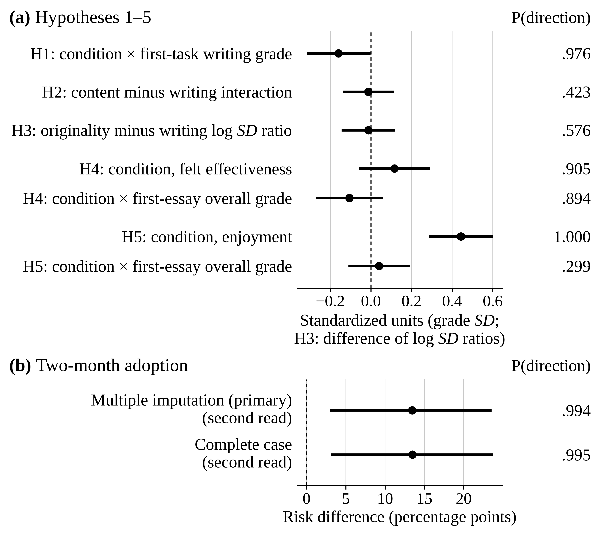

# ChatGPT Access and Writing Skill: A Bayesian Reanalysis of an Online Randomized Experiment (2026)

**Author:** Matthew J. Monnot  
**Outlet:** *SocArXiv preprint*  
**PDF:** [Download preprint PDF →](/assets/pdfs/Monnot_2026_ChatGPT_Writing_SocArXiv_y2p75.pdf)  
**DOI:** 10.31235/osf.io/y2p75_v1  
**Link:** Preprint: SocArXiv, [https://doi.org/10.31235/osf.io/y2p75_v1](https://doi.org/10.31235/osf.io/y2p75_v1).  
**Data:** [Original OSF deposit →](https://doi.org/10.17605/OSF.IO/XD7QW)  
**Companion site:** [Figures and summary →](https://mjmonnot.github.io/chatgpt-writing-2026/)

<figure>
  
  <figcaption><em>Figure 2.</em> Effects of ChatGPT access on grades, ratings, and adoption (posterior medians, 95% equal-tailed credible intervals, and <em>P</em>(direction)). Click to enlarge.</figcaption>
</figure>

---

## Summary

I reanalyze Noy and Zhang’s (2023a) online randomized experiment with Bayesian models in brms and weakly informative priors. Under ChatGPT access, second-task writing grades depended less on first-task grades (−0.159 [−0.317, −0.002], *P*(direction) = .976), access was associated with higher enjoyment (0.44 [0.29, 0.60]), and two-month workplace ChatGPT use was 13.4 [3.0, 23.5] percentage points higher under access.

## Reference

Monnot, M. J. (2026). *ChatGPT access and writing skill: A Bayesian reanalysis of an online randomized experiment*. SocArXiv. Preprint: SocArXiv, [https://doi.org/10.31235/osf.io/y2p75_v1](https://doi.org/10.31235/osf.io/y2p75_v1).
