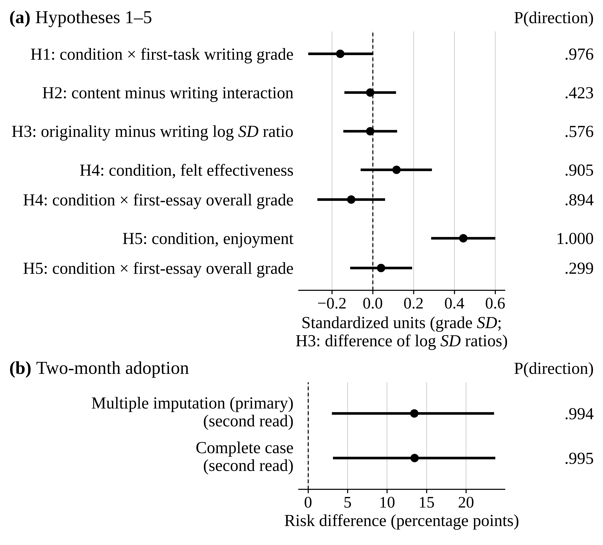

# ChatGPT Access and Writing Skill: A Bayesian Reanalysis of an Online Randomized Experiment (2026)

Key findings

<ol>
<li>In a randomized experiment with working professionals, people given access to ChatGPT had a weaker link between the writing quality of a first task and the writing quality of a second. Under the paper&rsquo;s Bayesian model that weakening is the likely sign (about a 98% probability), but it could be very small, and an ordinary least squares check with HC3 standard errors gave a 95% confidence interval of [−0.35, 0.02] that includes zero.</li>
<li>Professionals given ChatGPT enjoyed the writing task more.</li>
<li>Two months later, the share who said they had used ChatGPT or a similar chatbot at work in the past week was about 13 percentage points higher among those given access, with a range of about 3 to 24 points.</li>
</ol>

<a class="companion-btn" href="https://mjmonnot.github.io/chatgpt-writing-2026/">Companion site: figures and summary &rarr;</a>

**Author:** Matthew J. Monnot  
**Outlet:** *SocArXiv preprint*  
**PDF:** [Download preprint PDF →](/assets/pdfs/Monnot_2026_ChatGPT_Writing_SocArXiv_y2p75.pdf)  
**DOI:** 10.31235/osf.io/y2p75_v1  
**Link:** Preprint: SocArXiv, [https://doi.org/10.31235/osf.io/y2p75_v1](https://doi.org/10.31235/osf.io/y2p75_v1).  
**Data:** [Original OSF deposit →](https://doi.org/10.17605/OSF.IO/XD7QW)  

<figure>
  
  <figcaption><em>Figure 2.</em> Effects of ChatGPT access on grades, ratings, and adoption (posterior medians, 95% equal-tailed credible intervals, and <em>P</em>(direction)). Click to enlarge.</figcaption>
</figure>

---

## Summary

I fit Bayesian models in brms, with weakly informative priors, to data from Noy and Zhang’s (2023a) online randomized experiment. Under ChatGPT access, second-task writing grades depended less on first-task grades (posterior median −0.159, 95% CrI [−0.317, −0.002], *P*(direction) = .976), access was associated with higher enjoyment (0.44 [0.29, 0.60]), and two-month workplace ChatGPT use was 13.4 [3.0, 23.5] percentage points higher under access.

## Reference

Monnot, M. J. (2026). *ChatGPT access and writing skill: A Bayesian reanalysis of an online randomized experiment*. SocArXiv. Preprint: SocArXiv, [https://doi.org/10.31235/osf.io/y2p75_v1](https://doi.org/10.31235/osf.io/y2p75_v1).
