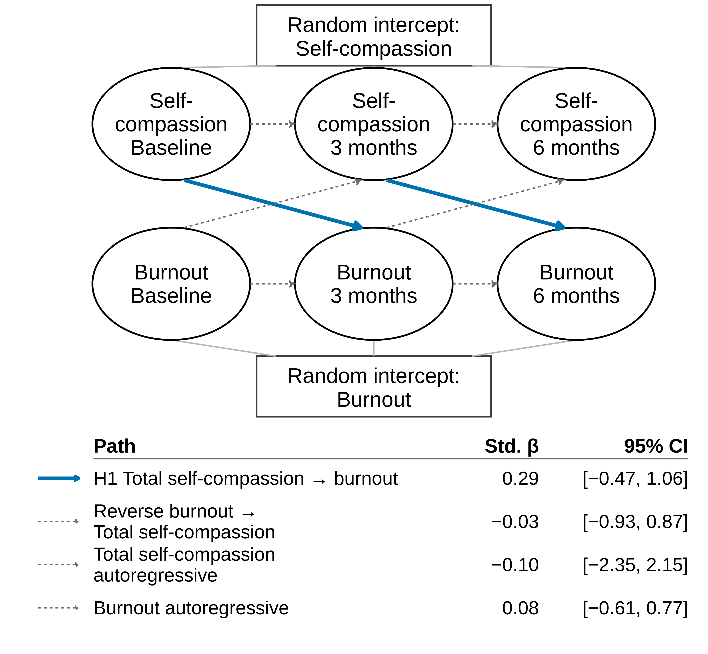

# Does Self-Compassion Precede Lower Burnout in Sports Coaches? A Within-Person Panel Study (2026)

**Author:** Matthew J. Monnot  
**Outlet:** *Preprints.org preprint*  
**PDF:** [Download preprint PDF →](/assets/pdfs/Monnot_2026_Coach_SelfCompassion_Preprints_202611_0474.pdf)  
**DOI:** [10.20944/preprints202611.0474.v1](https://doi.org/10.20944/preprints202611.0474.v1)  
**Link:** Preprint: Preprints.org, [https://doi.org/10.20944/preprints202611.0474.v1](https://doi.org/10.20944/preprints202611.0474.v1).  
**Data:** [Original Dryad deposit →](https://doi.org/10.5061/dryad.p5hqbzkrk)  
**Companion site:** [Figures and summary →](https://mjmonnot.github.io/coach-burnout-2026/)

<figure>
  
  <figcaption><em>Figure 1.</em> Within-person paths between self-compassion and burnout in a three-wave random-intercept cross-lagged panel model. Click to enlarge.</figcaption>
</figure>

---

## Summary

In a secondary analysis of a three-wave open panel of Swiss sports coaches (*N* = 422), I separate between-person differences from within-person change with a random-intercept cross-lagged panel model. Between coaches, self-compassion and burnout were negatively associated, *r* = −.48, 95% CI [−.60, −.37]. Scalar invariance held for burnout and perceived social support; partial scalar invariance held for self-compassion.

## Reference

Monnot, M. J. (2026). *Does self-compassion precede lower burnout in sports coaches? A within-person panel study*. *Preprints*. Preprint: Preprints.org, [https://doi.org/10.20944/preprints202611.0474.v1](https://doi.org/10.20944/preprints202611.0474.v1).
