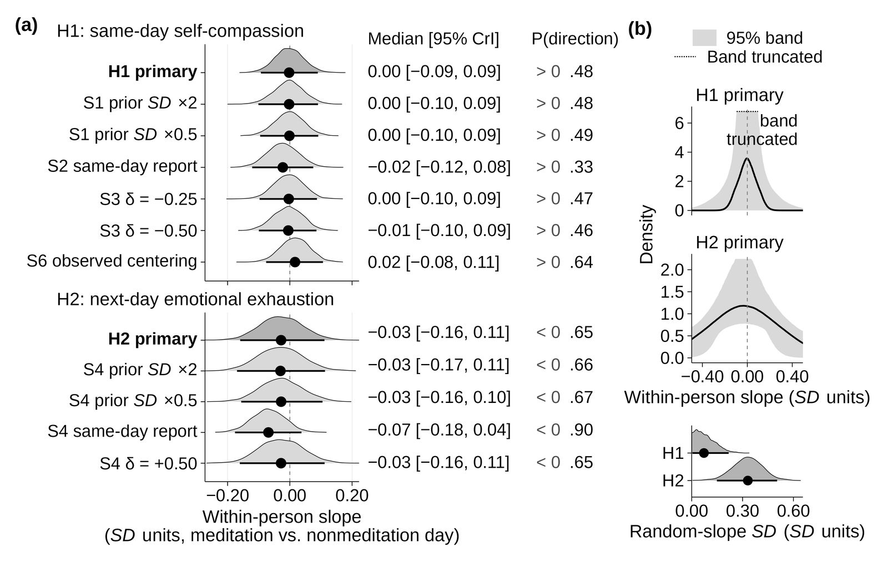

# Does Daily Meditation Increase Self-Compassion? A Bayesian Multilevel Diary Study (2026)

Key findings

<ol>
<li>During a two-week online self-compassion meditation program, employees were no more self-compassionate on the days they meditated than on the days they did not.</li>
<li>Meditating on a given day did not detectably reduce how emotionally exhausted they felt the next day.</li>
<li>This does not show that meditation fails to help. A benefit that builds over days and carries into days without practice would not appear in a day-by-day comparison, and the study had 65 employees and no comparison group.</li>
</ol>

<a class="companion-btn" href="https://mjmonnot.github.io/meditation-diary-2026/">Companion site: figures and summary &rarr;</a>

**Authors:** Matthew J. Monnot  
**Outlet:** *PsyArXiv preprint*  
**PDF:** [Download preprint PDF →](/assets/pdfs/Monnot_2026_Meditation_SelfCompassion_Diary_PsyArXiv_986ht.pdf)  
**DOI:** 10.31234/osf.io/986ht_v1  
**Link:** [Read the preprint →](https://doi.org/10.31234/osf.io/986ht_v1)  
**Code and protocol:** [Project repository →](https://github.com/mjmonnot/selfcompassion-diary-preprint)  
**Data:** [Original study's deposit (Li, 2021) →](https://osf.io/pqf6v/)  

<figure>
  
  <figcaption><em>Figure 2.</em> Posterior distributions of the within-person meditation slope across the primary and sensitivity models (medians, 95% credible intervals, zero dashed), and the implied variation in person-specific slopes. Click to enlarge.</figcaption>
</figure>

---

## Summary

This study used an archival 28-day diary of 65 employees in a two-week online self-compassion meditation program (Li et al., 2021) to ask a question the original phase comparison did not: do a person's meditation days differ from their nonmeditation days? Across the 14 intervention days, a prespecified Bayesian two-level model treated each person's meditation tendency as latent, which keeps the within-person contrast separate from stable differences in meditation frequency when nonmeditation days are few. The within-person slope for same-day self-compassion was 0.00 SD (95% CrI [−0.09, 0.09], P(b > 0) = .48), and the slope for next-day emotional exhaustion, adjusting for same-day exhaustion, was −0.03 SD (95% CrI [−0.16, 0.11], P(b < 0) = .65). Both intervals spanned zero. The estimates changed little across priors and missing-data shifts. Reading meditation reports as same-day moved the next-day exhaustion estimate furthest, to −0.07 (95% CrI [−0.18, 0.04]). Within the program, the estimates gave no indication that the changes were concentrated on the days on which employees actually practiced.

## Reference

Monnot, M. J. (2026). *Does daily meditation increase self-compassion? A Bayesian multilevel diary study*. PsyArXiv. [https://doi.org/10.31234/osf.io/986ht_v1](https://doi.org/10.31234/osf.io/986ht_v1).
