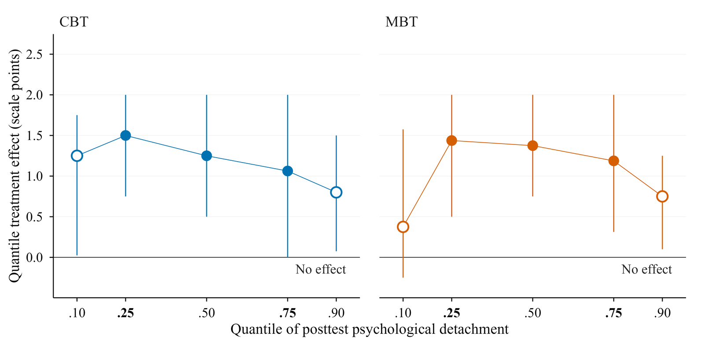

# Active Recovery Is Not Just for Athletes: Employees Need to Train for Recovery to Enhance Work (2026)

Key findings

<ol>
<li>Two six-week programs, one cognitive-behavioral and one mindfulness-based, each helped employees mentally switch off from work (psychological detachment). Among employees who answered the survey after the training, the gain over a wait-list group was about 0.9 points on a 7-point scale.</li>
<li>Neither program clearly worked better for employees who struggled most to switch off at the start, or for those who already did it well.</li>
<li>The trial of 393 German employees was too small to settle who benefits most. Its results limit how large any such difference could be.</li>
</ol>

<a class="companion-btn" href="https://mjmonnot.github.io/recovery-training-2026/">Companion site: figures and summary &rarr;</a>

**Authors:** Matthew J. Monnot  
**Outlet:** *SocArXiv preprint*  
**PDF:** [Download preprint PDF →](/assets/pdfs/Monnot_2026_Active_Recovery_SocArXiv_cz5g4.pdf)  
**DOI:** 10.31235/osf.io/cz5g4_v1  
**Link:** Preprint: SocArXiv, [https://doi.org/10.31235/osf.io/cz5g4_v1](https://doi.org/10.31235/osf.io/cz5g4_v1).  
**Data:** [Trial team's deposit →](https://osf.io/32rhy/)  

<figure>
  
  <figcaption><em>Figure 2.</em> Differences from control in posttest detachment quantiles at .10, .25, .50, .75, and .90, with pointwise 95% bootstrap confidence intervals. Click to enlarge.</figcaption>
</figure>

---

## Summary

A prespecified analysis of data from a randomized trial among German employees (*N* = 393; Peuckmann et al., 2026) tested whether a cognitive-behavioral and a mindfulness-based recovery training raised psychological detachment more for employees who detached least or for those who already detached well. Both trainings raised detachment at the mean baseline by about 0.9 points, but the baseline × condition interactions were −0.21 (95% CI [−0.50, 0.08]) and 0.04 (95% CI [−0.24, 0.33]). The results support neither compensation nor accumulation, and the intervals bound how large either pattern could be in a trial of this size.

## Reference

Monnot, M. J. (2026). *Active recovery is not just for athletes: Employees need to train for recovery to enhance work*. SocArXiv. Preprint: SocArXiv, [https://doi.org/10.31235/osf.io/cz5g4_v1](https://doi.org/10.31235/osf.io/cz5g4_v1).
